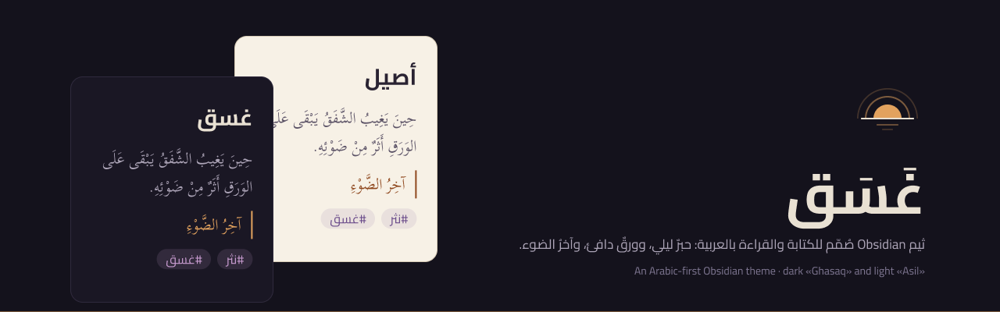
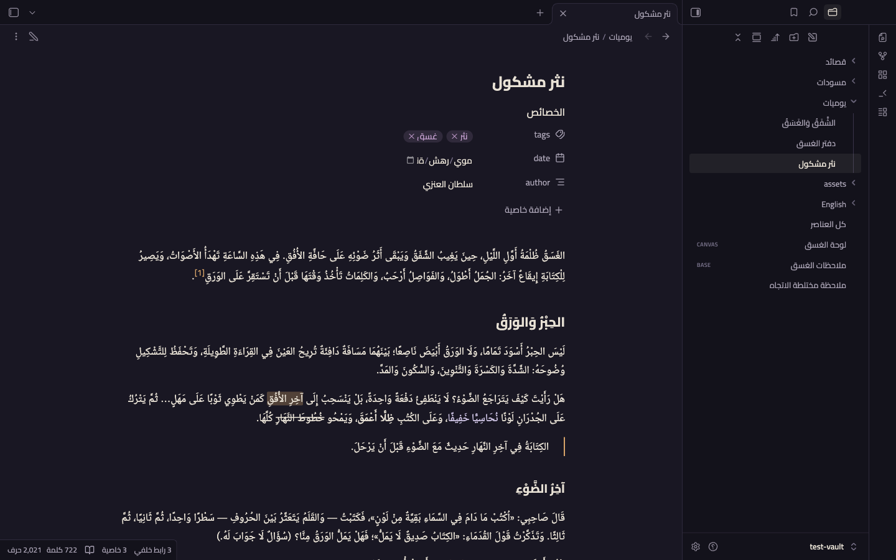
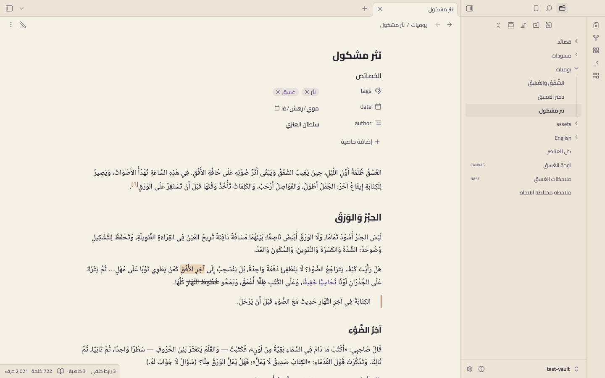
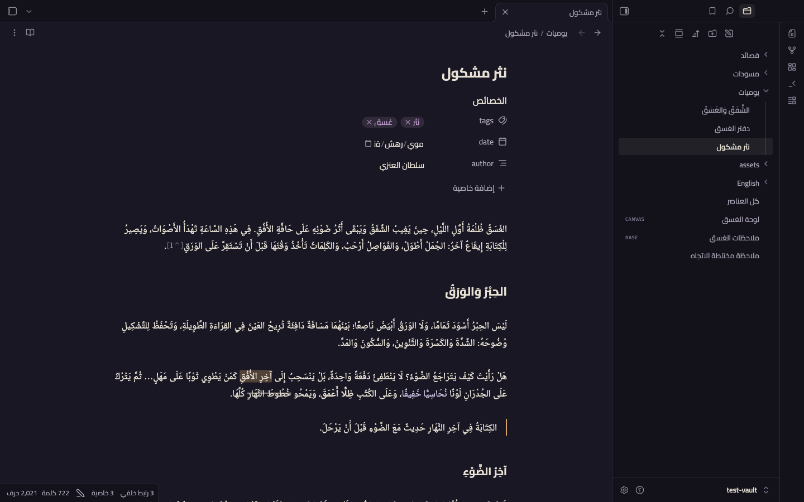
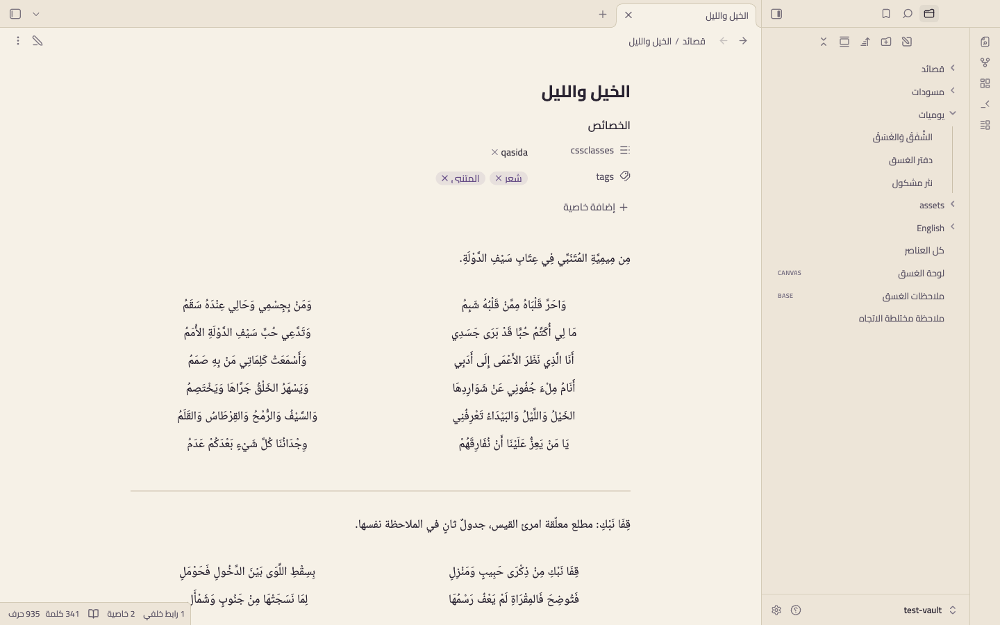
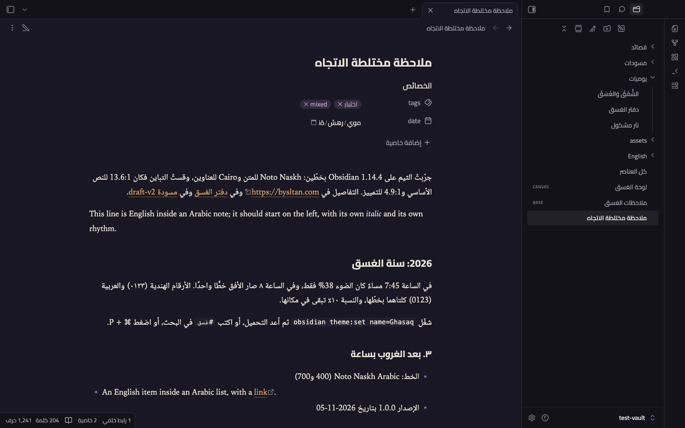
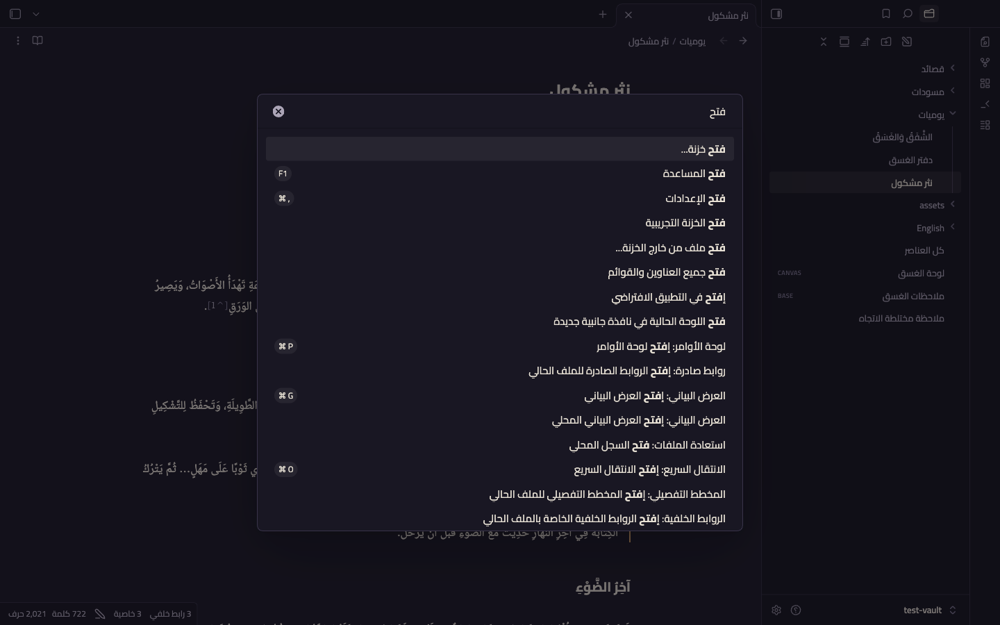

<p align="center">
  
</p>

<h1 align="center">Ghasaq · غَسَق</h1>

<p align="center">An Arabic-first Obsidian theme for long-form writing and reading: violet night ink, warm paper and an amber last light.</p>

<p align="center">
  <a href="https://github.com/iSltanX/Ghasaq/releases/latest"></a>
  <a href="LICENSE"></a>
  
</p>

<p align="center">
  <a href="#previews">Previews</a> ·
  <a href="#installation">Installation</a> ·
  <a href="#style-settings">Style Settings</a> ·
  <a href="#qasida-mode">Qasida mode</a> ·
  <a href="#development">Development</a> ·
  <a href="README.md">العربية</a>
</p>

## About

*Ghasaq* (غَسَق) is Arabic for the first darkness of night, when the afterglow fades and only a trace of its light remains. The theme is designed for writing and reading Arabic from the ground up, not an English theme translated later. It is built on three elements:

- **Ink:** violet-leaning night surfaces.
- **Paper:** warm text, never stark white.
- **The last light:** an amber accent used sparingly, on links, the caret and buttons.

The dark mode is called **Ghasaq** and the light mode **Asil** (*late afternoon, before sunset*). The whole identity was designed in Figma first; the theme's colours, sizes and type are generated from Figma variables.

The benchmark is a long, fully vowelled Arabic note with an English line, a code block, a table and a classical poem. All of it should sit in the right place and be easy on the eye, in both modes, under both the Arabic and the English interface.

## Previews

Real screenshots from Obsidian 1.15.0 with the Arabic interface.

| Ghasaq · Reading | Asil · Reading |
|---|---|
|  |  |
| **Ghasaq · Live Preview** | **Asil · Qasida** |
|  |  |
| **Mixed-direction note** | **Command palette** |
|  |  |

More in [`screenshots/`](screenshots/), including a full matrix: both modes, the Arabic and English interfaces, editing and reading, Canvas, Graph view, Bases and Settings.

## Features

**Arabic typography**
- Body text in embedded **Noto Naskh Arabic**, with real 400 and 700 weights and a 1.9 line height so diacritics never collide.
- Headings and the interface in embedded **Cairo**, so the UI looks the same on every system.
- The Arabic face is limited to Arabic characters (`unicode-range`), so Latin words fall back to a system serif with a true italic.
- **No synthetic italic for Arabic:** emphasis uses a soft colour instead of a slant.
- **No letter-spacing:** zero on any text that may be Arabic.
- **No clipped diacritics:** in tabs, the file explorer, the outline and headings.
- The visual size of Arabic and Latin is balanced with `size-adjust`, without touching the font size you choose.

**Direction and mixed text**
- Builds on Obsidian's native RTL support instead of fighting it, and fills the gaps:
  - Code blocks, math and Mermaid are always LTR.
  - Inline code is isolated inside an Arabic line.
  - Hotkeys don't flip.
  - The collapsed-callout arrow points towards the end of the line.
- Blockquote borders, callout icons, bullets, tasks, numbers, tables, footnotes, fold arrows, line numbers and the properties panel all sit on the correct side in both directions.

**Colour**
- A full `--color-base` scale for each mode, with code, callouts, Canvas and Graph colours from one family.
- Contrast is checked against WCAG on every build: body text at 11:1 or higher; secondary text, accent and tags at 4.5:1 or higher.
- If you pick an accent colour in Obsidian's settings, yours wins; amber is only the default.

## Installation

### From the theme browser

Settings → Appearance → Themes → Manage, search for **Ghasaq** and click *Use* (once accepted into the community directory).

### Manually

1. Download `manifest.json` and `theme.css` from the [latest release](https://github.com/iSltanX/Ghasaq/releases/latest).
2. Put them in `.obsidian/themes/Ghasaq/` inside your vault.
3. Pick Ghasaq under Settings → Appearance.

Requires Obsidian **1.14.4** or newer. Tested on 1.14.4 and 1.15.0 on macOS.

## Style Settings

The theme is complete without the [Style Settings](https://github.com/obsidian-community/obsidian-style-settings) plugin. With it installed you get these options (labelled in Arabic):

| Option | What it does |
|---|---|
| Body font | Leave empty for the embedded font, or type the name of a font installed on your system (e.g. Amiri) |
| Line height | 1.6 to 2.2 (default 1.9) |
| Reading width | 560 to 960 px (default 720) |
| Text alignment | Start (default) or justified. Chromium has no kashida support, so justification widens spaces |
| Accent | Amber (default), copper or dusk violet |
| Heading colour | Text colour (default) or accent |
| Higher contrast | Raises the contrast of secondary and faint text and borders |
| Ornamental `---` | A small diamond in the last-light colour between two lines |
| Justified hemistichs | Stretches each hemistich across its column instead of centring it |

## Qasida mode

Add the `qasida` class to the note's properties and write the verses as a two-column table: the first hemistich (*sadr*) in the first column and the second (*ajuz*) in the second. Leave the header row empty; Markdown requires it and the theme hides it.

```markdown
---
cssclasses:
  - qasida
---

| | |
| --- | --- |
| الخَيْلُ وَاللَّيْلُ وَالبَيْدَاءُ تَعْرِفُنِي | وَالسَّيْفُ وَالرُّمْحُ وَالقِرْطَاسُ وَالقَلَمُ |
| أَنَا الَّذِي نَظَرَ الأَعْمَى إِلَى أَدَبِي | وَأَسْمَعَتْ كَلِمَاتِي مَنْ بِهِ صَمَمُ |
```

**The result:**
- The first hemistich sits at the start and the second after it, in two equal widths with a clear gap between them.
- No borders and no header.
- Works in Reading view and Live Preview, handles full vowelling, and stays RTL even under an English interface.

The note stays plain Markdown. If you ever switch themes, the verses still read as a table.

## Fonts

| Font | Used for | License |
|---|---|---|
| [Noto Naskh Arabic](https://github.com/notofonts/arabic) | Body text (Arabic characters) | SIL OFL 1.1: [`fonts/OFL-NotoNaskhArabic.txt`](fonts/OFL-NotoNaskhArabic.txt) |
| [Cairo](https://github.com/Gue3bara/Cairo) | Headings and interface | SIL OFL 1.1: [`fonts/OFL-Cairo.txt`](fonts/OFL-Cairo.txt) |

Both fonts are embedded in `theme.css` as subset woff2, so the theme makes no network requests. Latin words in body text use the system serif (Iowan Old Style → Charter → Georgia), and code uses the system monospace font.

## Known issues

- **Date field in properties:** shows the "day/month/year" placeholder reversed under the Arabic interface. This is an Obsidian/Chromium bug that also appears in the default theme.
- **An image alone on its line:** is laid out LTR, because a line with no strong character gets an LTR direction from `dir=auto`. This is Obsidian's behaviour.
- **Mobile, Windows and Linux:** not yet tested on real devices.

## Issues and ideas

- **Found a bug?** [Open an issue](https://github.com/iSltanX/Ghasaq/issues/new) with a screenshot, your Obsidian version, device and interface language.
- **Have an idea?** [Open a suggestion](https://github.com/iSltanX/Ghasaq/issues/new) and describe what you'd like.

## Development

- **Figma is the source of truth:** colours, sizes and type are changed there. Then run `scripts/figma/export-variables.js` through the Figma MCP and save its output to `tokens/figma.json`.
- **One build command:**

  ```
  python3 scripts/build.py
  ```

  It generates `src/tokens.css` and `src/fonts.css` and concatenates `src/` into `theme.css`. The build fails if contrast drops, a physical property appears outside the documented LTR zones, `!important` or an external URL shows up, the file exceeds 700 KB, or `manifest.json` or the Style Settings block is invalid.
- **Test scripts:**
  - `scripts/obsidian-test.sh`: runs an isolated Obsidian instance on `test-vault/`. The Style Settings plugin is not committed; install it in the vault from the community directory, or copy it to `test-vault/.obsidian/plugins/obsidian-style-settings/`.
  - `scripts/cli-check.sh`: checks the theme through the Obsidian CLI.
  - `scripts/shoot-matrix.sh`: captures the screenshot matrix.
- **Releasing:** bump `version` in `manifest.json`, add a line to [CHANGELOG.md](CHANGELOG.md) and push a tag with the same number; GitHub Actions creates a draft release.

## Credits & license

Fonts: [Noto Naskh Arabic](https://github.com/notofonts/arabic) by the Noto Project Authors and [Cairo](https://github.com/Gue3bara/Cairo) by the Cairo Project Authors, both SIL OFL 1.1 ([`fonts/NOTICE.md`](fonts/NOTICE.md)). Thanks to the [Style Settings](https://github.com/obsidian-community/obsidian-style-settings) plugin and to the [Obsidian](https://obsidian.md) team for right-to-left support. Theme code: [MIT](LICENSE).

---

<p align="center"><sub>
  Design &amp; development: Sultan Al-Anazi — سلطان العنزي · <a href="https://bysltan.com">bysltan.com</a>
</sub></p>
