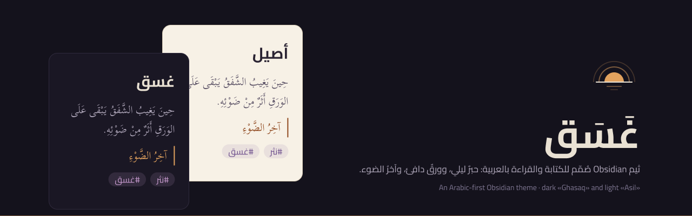
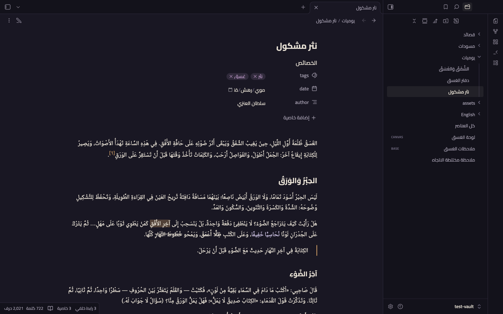
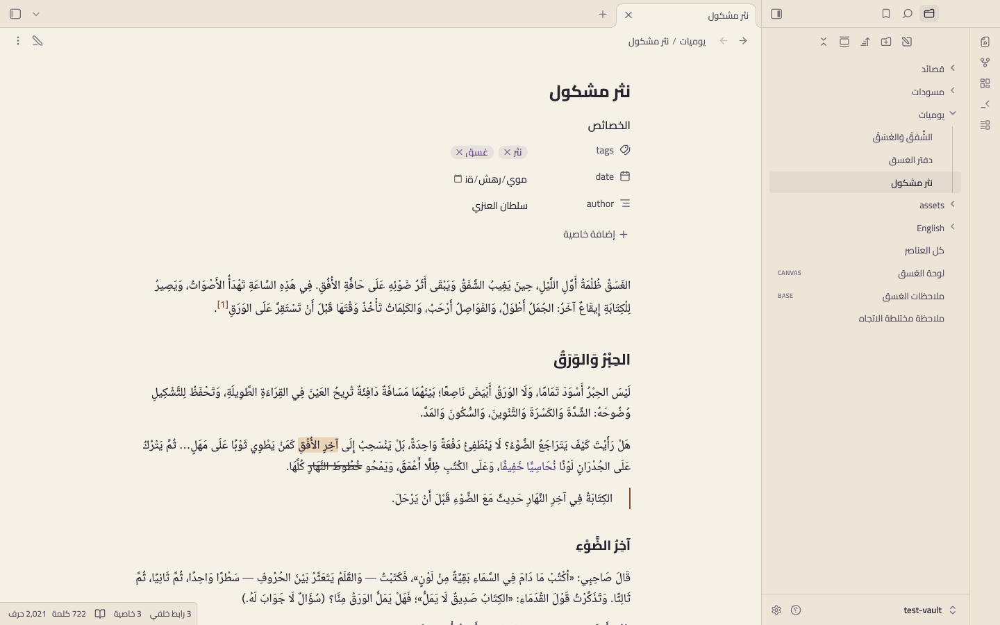
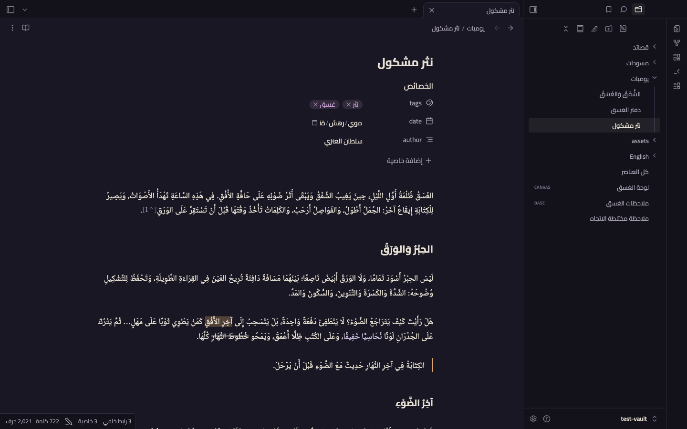
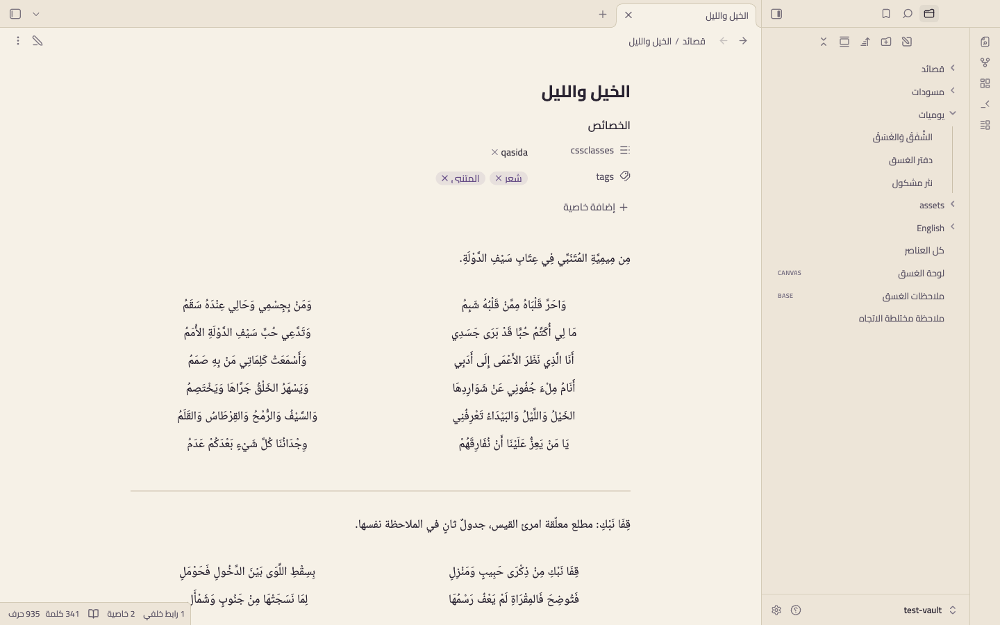
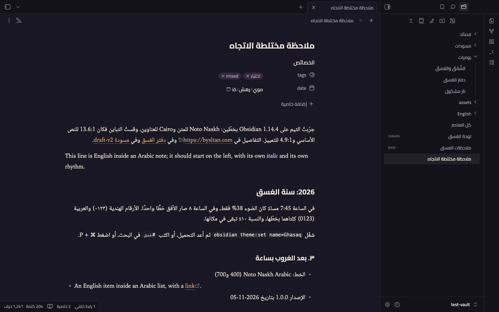
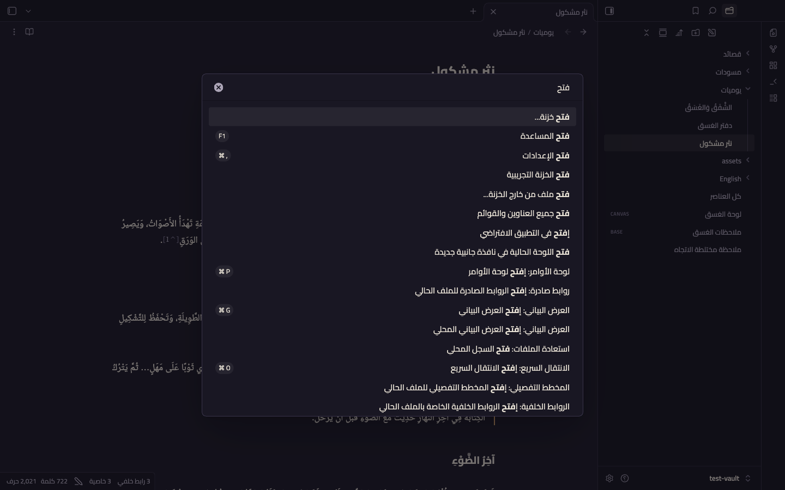

<p align="center"></p>

<div dir="rtl">

<h1 align="center">غَسَق · Ghasaq</h1>

<p align="center">ثيم Obsidian صُمّم للكتابة والقراءة بالعربية من أوّله: حبرٌ ليلي، وورقٌ دافئ، وآخرُ الضوء.</p>

<p align="center" dir="ltr"><b>An Arabic-first Obsidian theme</b> for long-form writing and reading: violet night ink, warm paper and an amber last light. Dark «Ghasaq» and light «Asil» modes, embedded Noto Naskh Arabic and Cairo, careful right-to-left layout and a qasida mode for classical verse. <a href="#english">English documentation ↓</a></p>

## الفكرة

الغَسَق ظلمة أول الليل، حين يغيب الشفق ويبقى أثر ضوئه. يقوم الثيم على ثلاثة عناصر:

- **حبر:** خلفيات ليلية مائلة إلى البنفسجي.
- **ورق:** نصٌّ دافئ لا أبيض ناصع.
- **آخر الضوء:** لون تمييز كهرماني يُستعمل قليلًا، في الروابط والمؤشر والأزرار.

الوضع الداكن «**غَسَق**» هو الأصل، والوضع الفاتح «**أصيل**» آخر النهار قبل الغروب. صُمّمت الهوية كاملة في Figma أولًا، ثم اشتُقّت ألوان الثيم ومقاساته منها آليًا.

المعيار: ملاحظة عربية طويلة مشكولة، فيها سطر إنجليزي وكتلة شيفرة وجدول وقصيدة عمودية. ينبغي أن يظهر ذلك كله في موضعه الصحيح، ومريحًا للعين، في الوضعين، وتحت الواجهة العربية والإنجليزية.

## المعاينة

لقطات حقيقية من Obsidian 1.15.0 بواجهة عربية.

| غَسَق · قراءة | أصيل · قراءة |
|---|---|
|  |  |
| **غَسَق · Live Preview** | **أصيل · قصيدة عمودية** |
|  |  |
| **ملاحظة مختلطة الاتجاه** | **لوحة الأوامر** |
|  |  |

بقية اللقطات في [`screenshots/`](screenshots/). وفيها مصفوفة كاملة: الوضعان، والواجهتان العربية والإنجليزية، والتحرير والقراءة، وCanvas، والرسم البياني، وBases، والإعدادات.

## ما يقدّمه

**الطباعة العربية**
- المتن بخط **Noto Naskh Arabic** مضمَّنًا، بوزنين حقيقيين 400 و700، وارتفاع سطر 1.9 حتى لا يتصادم التشكيل.
- العناوين والواجهة بخط **Cairo** مضمَّنًا، فتتّحد الواجهة على كل الأنظمة.
- الخط العربي مقصور على الحروف العربية (`unicode-range`)، فتأخذ الكلمات اللاتينية خطًّا لاتينيًا من النظام، بمائل حقيقي.
- **لا ميل اصطناعي للعربية:** التوكيد بلون خفيف بدل الميل.
- **لا تباعد حروف:** صفر في كل نص قد يكون عربيًا.
- **لا قصّ للتشكيل:** في التبويبات والمستكشف والمخطط والعناوين.
- الحجم البصري بين العربي واللاتيني موزون بـ `size-adjust`، دون المساس بحجم الخط الذي تختاره.

**الاتجاه والنص المختلط**
- يبني على دعم Obsidian الأصلي لـ RTL ولا يحاربه، ويكمل ما ينقصه:
  - كتل الشيفرة والرياضيات وMermaid LTR دائمًا.
  - الشيفرة المضمّنة معزولة داخل السطر العربي.
  - اختصارات المفاتيح لا تنقلب.
  - سهم الـ callout المطويّ يشير إلى جهة نهاية السطر.
- حدّ الاقتباس، وأيقونة الـ callout، والنقاط، والمهام، والأرقام، والجداول، والحواشي، وأسهم الطيّ، وأرقام الأسطر، ولوحة الخصائص: كلها في جهتها في الاتجاهين.

**الألوان**
- سلّم `--color-base` كامل لكل وضع، وألوان الشيفرة والـ callouts وCanvas والرسم البياني من عائلة واحدة.
- التباين مفحوص آليًا وفق WCAG في كل بناء: النص الأساسي 11:1 فأكثر، والثانوي والتمييز والوسوم 4.5:1 فأكثر.
- إن اخترت لون تمييز من إعدادات Obsidian فاختيارك يتقدّم، والكهرماني افتراضي فقط.

## التثبيت

**من متجر Obsidian:** الإعدادات ← المظهر ← السمات ← إدارة، ثم ابحث عن **Ghasaq** (بعد قبوله في المتجر).

**يدويًا:**
1. نزّل `manifest.json` و`theme.css` من [آخر إصدار](https://github.com/iSltanX/ghasaq/releases/latest).
2. ضعهما في `.obsidian/themes/Ghasaq/` داخل خزينتك.
3. اختر Ghasaq من الإعدادات ← المظهر.

يحتاج Obsidian **1.14.4** فأحدث. اختُبر على 1.14.4 و1.15.0 على macOS.

## خيارات Style Settings

الثيم يعمل كاملًا بدون إضافة [Style Settings](https://github.com/obsidian-community/obsidian-style-settings). إن ثبّتّها ظهرت الخيارات التالية بعناوين عربية:

| الخيار | ما يفعله |
|---|---|
| خط المتن | اتركه فارغًا للخط المضمَّن، أو اكتب اسم خط مثبّت على جهازك (مثل Amiri) |
| ارتفاع السطر | من 1.6 إلى 2.2 (الافتراضي 1.9) |
| عرض سطر القراءة | من 560 إلى 960 بكسل (الافتراضي 720) |
| محاذاة المتن | بداية السطر (افتراضي) أو ضبط. Chromium لا يدعم الكشيدة، فالضبط يوسّع الفراغات |
| لون التمييز | كهرماني (افتراضي)، أو نحاسي، أو بنفسجي غسقي |
| لون العناوين | بلون النص (افتراضي) أو بلون التمييز |
| تباين أعلى | يرفع تباين النص الثانوي والخافت والحدود |
| فاصل `---` مزخرف | معيّن صغير بلون آخر الضوء بين خطين |
| ضبط الشطر في القصيدة | يمدّ كل شطر على عرض عموده بدل توسيطه |

## وضع القصيدة العمودية

أضف الصنف `qasida` إلى خصائص الملاحظة، واكتب الأبيات جدولًا من عمودين: الصدر في العمود الأول، والعجز في الثاني. اترك صف الترويسة فارغًا، فهو صف يفرضه Markdown والثيم يخفيه.

```markdown
---
cssclasses:
  - qasida
---

| | |
| --- | --- |
| الخَيْلُ وَاللَّيْلُ وَالبَيْدَاءُ تَعْرِفُنِي | وَالسَّيْفُ وَالرُّمْحُ وَالقِرْطَاسُ وَالقَلَمُ |
| أَنَا الَّذِي نَظَرَ الأَعْمَى إِلَى أَدَبِي | وَأَسْمَعَتْ كَلِمَاتِي مَنْ بِهِ صَمَمُ |
```

**النتيجة:**
- الصدر في جهة البداية والعجز بعده، بعرضين متساويين، وبينهما فراغ واضح.
- بلا حدود ولا ترويسة.
- يعمل في وضع القراءة وفي Live Preview، ويتحمّل التشكيل التام، ويبقى RTL حتى تحت واجهة إنجليزية.

## الخطوط ورخصها

| الخط | الاستعمال | الرخصة |
|---|---|---|
| [Noto Naskh Arabic](https://github.com/notofonts/arabic) | المتن (الحروف العربية) | SIL OFL 1.1: [`fonts/OFL-NotoNaskhArabic.txt`](fonts/OFL-NotoNaskhArabic.txt) |
| [Cairo](https://github.com/Gue3bara/Cairo) | العناوين والواجهة | SIL OFL 1.1: [`fonts/OFL-Cairo.txt`](fonts/OFL-Cairo.txt) |

الخطّان مضمَّنان في `theme.css` بصيغة woff2 مجزّأة، فلا طلبات شبكة. الكلمات اللاتينية في المتن تأخذ خط النظام (Iowan Old Style ← Charter ← Georgia)، والشيفرة خط mono النظام.

## حدود معروفة

- **حقل التاريخ في الخصائص:** يعرض حروف «يوم/شهر/سنة» معكوسة تحت الواجهة العربية. هذا عيب في Obsidian/Chromium يظهر في الثيم الافتراضي أيضًا.
- **الصورة المنفردة في سطرها:** تأخذ اتجاه LTR، لأن السطر بلا حرف قوي فيأخذ `dir=auto` اتجاه LTR، وهذا سلوك Obsidian.
- **الجوال وWindows وLinux:** لم تُختبر على أجهزة حقيقية بعد.

## التطوير

- **الهوية في Figma هي مصدر الحقيقة:** الألوان والمقاسات والطباعة تُعدَّل هناك. ثم يُشغَّل `scripts/figma/export-variables.js` عبر Figma MCP، ويُحفظ ناتجه في `tokens/figma.json`.
- **أمر البناء الواحد:**

  ```
  python3 scripts/build.py
  ```

  يولّد `src/tokens.css` و`src/fonts.css`، ويجمع `src/` في `theme.css`. ويُفشل البناء إن نزل التباين، أو ظهرت خاصية فيزيائية خارج مناطق LTR الموثّقة، أو `!important`، أو رابط خارجي، أو تجاوز الحجم 700KB، أو فسد `manifest.json` أو كتلة Style Settings.
- **سكربتات الاختبار:**
  - `scripts/obsidian-test.sh`: يشغّل نسخة Obsidian معزولة على `test-vault/`. إضافة Style Settings لا تُرفع مع المستودع؛ ثبّتها في الخزينة من المتجر، أو انسخها إلى `test-vault/.obsidian/plugins/obsidian-style-settings/`.
  - `scripts/cli-check.sh`: يتحقق عبر Obsidian CLI.
  - `scripts/shoot-matrix.sh`: يلتقط مصفوفة اللقطات.

## الرخصة

الثيم برخصة [MIT](LICENSE). الخطوط المضمَّنة برخصة SIL Open Font License 1.1.

</div>

---

<a id="english"></a>

## English

**Ghasaq** (غَسَق, *the first darkness of night*) is an Obsidian theme designed for writing and reading Arabic from the ground up, not an English theme translated later. It is built on three elements:

- **Ink:** violet-leaning night surfaces.
- **Paper:** warm text, never stark white.
- **The last light:** an amber accent used sparingly.

The dark mode is called **Ghasaq** and the light mode **Asil** (*late afternoon*). The whole identity was designed in Figma first; the theme's colours, sizes and type are generated from Figma variables.

### Highlights

- **Embedded Arabic type:** Noto Naskh Arabic for body text (real 400/700 weights, 1.9 line height so diacritics never collide) and Cairo for headings and UI, both bundled as subset woff2.
- **Latin stays Latin:** the Arabic face is limited by `unicode-range`, so Latin words fall back to a system serif with a true italic. The visual size of the two scripts is balanced with `size-adjust`, without touching your chosen font size.
- **No harm to Arabic:** zero letter-spacing, no synthetic italic for Arabic (emphasis uses colour), and no clipped diacritics in tabs, file explorer, outline or headings.
- **Works with Obsidian's native RTL support:** code blocks, math and Mermaid are always LTR, inline code is isolated, hotkeys don't flip, and the collapsed-callout arrow points the right way. Blockquote borders, callouts, lists, tasks, tables, footnotes, fold arrows, line numbers, properties and embeds sit on the correct side in both directions.
- **Contrast is checked on every build** (WCAG): body text ≥ 11:1, secondary/accent/tags ≥ 4.5:1.
- **Your accent wins:** an accent chosen in Obsidian's settings always takes precedence over the theme's amber.
- **Qasida mode:** `cssclasses: [qasida]` turns two-column tables into classical Arabic verse (equal hemistichs, no borders, hidden header) in Reading view and Live Preview.

### Installation

From the community theme browser, search for **Ghasaq** (once accepted). To install manually, download `manifest.json` and `theme.css` from the latest release into `.obsidian/themes/Ghasaq/`. Requires Obsidian 1.14.4 or newer; tested on 1.14.4 and 1.15.0 (macOS).

### Style Settings

The theme is complete without the [Style Settings](https://github.com/obsidian-community/obsidian-style-settings) plugin. With it installed you get:

- Body font
- Line height
- Reading width
- Text alignment
- Accent (amber, copper or dusk violet)
- Heading colour
- Higher contrast
- An ornamental `---` divider
- Justified hemistichs for qasida notes

### Fonts and licence

The theme is MIT licensed. The embedded fonts are Noto Naskh Arabic and Cairo, both under the SIL Open Font License 1.1; see `fonts/`.
