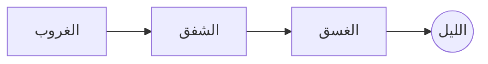

---
tags:
  - عناصر
  - اختبار
date: 2026-11-05
author: سلطان العنزي
status: مسودة
aliases:
  - العناصر
---
# عنوان أول: فِي وَصْفِ الغَسَقِ
## عنوان ثانٍ: الحِبْرُ وَالوَرَقُ
### عنوان ثالث: آخِرُ الضَّوْءِ
#### عنوان رابع: مُلَاحَظَاتٌ عَلَى الهَامِشِ
##### عنوان خامس: تَفْصِيلٌ صَغِيرٌ
###### عنوان سادس: حَاشِيَةُ العُنْوَانِ

فقرة عادية بعد العناوين فيها **عريض** و*توكيد* و==تظليل== و~~شطب~~ و`شيفرة مضمّنة` ورابط [[نثر مشكول]] ورابط غير موجود [[ملاحظة لم تُكتب بعد]] وحاشية[^a]. %%تعليق مخفي%%

## القوائم

- البند الأول
	- بند متداخل
		- بند في المستوى الثالث
	- بند متداخل آخر
- البند الثاني
	1. رقم داخل نقطة
	2. رقم ثانٍ

1. الأول
2. الثاني
	- نقطة داخل رقم
3. الثالث

- [x] مهمة منجزة
- [ ] مهمة لم تُنجز
	- [ ] مهمة فرعية
	- [x] مهمة فرعية منجزة

## الاقتباس

> اقتباس من سطر واحد.
>
> > اقتباس داخل اقتباس، بحدٍّ في جهة البداية.

## Callouts

> [!note] ملاحظة
> عنوان التنبيه وأيقونته في جهة بداية السطر.

> [!abstract] خلاصة
> نصّ الخلاصة.

> [!info] معلومة
> نصّ المعلومة.

> [!todo] مهمّة
> نصّ المهمة.

> [!tip] تلميح
> نصّ التلميح.

> [!success] تمّ
> نصّ النجاح.

> [!question]- لماذا الغسق؟ (مطويّ)
> لأنّ الضوء فيه لا يغيب كلّه.

> [!question]+ سؤال مفتوح قابل للطيّ
> هذا callout مفتوح ويمكن طيّه.

> [!warning] تنبيه
> نصّ التنبيه.

> [!failure] إخفاق
> نصّ الإخفاق.

> [!danger] خطر
> نصّ الخطر.

> [!bug] علّة
> نصّ العلّة.

> [!example] مثال
> نصّ المثال.

> [!quote] اقتباس
> نصّ الاقتباس.

## الجدول

| الخط | الوزن | الاستعمال | محاذاة وسطى |
| :--- | ---: | --- | :---: |
| نسخ | 400 | المتن والقراءة | ✓ |
| نسخ | 700 | العريض | ✓ |
| Cairo | 400–700 | العناوين والواجهة | ✓ |

## الرياضيات

المعادلة المضمّنة $e^{i\pi} + 1 = 0$ داخل سطر عربي.

$$
\int_0^1 x^2 \, dx = \frac{1}{3}
$$

## Mermaid



## الشيفرة

```python
# غسق
def fade(light: float, t: float) -> float:
    """يخفت الضوء مع الوقت."""
    return max(0.0, light - t)
```

```css
body { --accent-h: 31; }
.theme-dark { --background-primary: #1A1724; }
```

```bash
obsidian vault=test-vault theme:set name=Ghasaq
```

## الوسوم والتضمين والصورة

#غسق #كتابة/يومية #writing

![[دفتر الغسق#اقتباس للتضمين]]

![[غسق.png|160]]

---

[^a]: نصّ الحاشية في أسفل الملاحظة.
